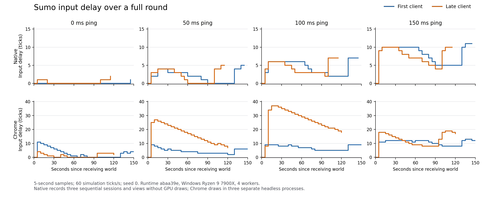

# Benchmarks

Simulation benchmarks compare the same deterministic work in Tide and hand-written C. Build and run them with `cmake --build --preset release --target versus`; individual `build/release/bin/versus_<concept>` programs list their options with `--help`. Save repeated measurements with `--save <label>` in `bench/results/versus.jsonl`.

Set `TIDE_BENCH_MACHINE` to the CPU/machine and `TIDE_BENCH_REVISION` to the source revision and local changes before saving simulation or session runs, as for drawing below. New rows also record architecture, compiler version and whether C splitting was forced (`--split`, or `--quick`). Comparisons group matching options, machine, compiler and thread counts; older rows without that metadata form separate groups. Unidentified machines are reported as `unknown`; provide the machine label when comparing machines.

## Coverage and the October 6 audit

The suite covers ECS streaming, grid blocks and stencils, entity churn, event dispatch, pairwise list calculations, nested lists, ordered maps/sets, and networked prediction/joining. `versus_lookup` adds map/set hits and misses, score updates, deletion/reinsertion and duplicate set additions. Its digest includes insertion order and observed results. `--changes 0` isolates hits, misses and updates without key replacement. The C implementation uses separate ordered open-addressed tables with backshift deletion; it calls no Tide container functions. Quick checks include empty/single collections and replacement past the collection's size, on native and WebAssembly.

`versus_particles --kept 1` and `versus_buckets --kept 1` keep the previous state before each tick. Tide shares pages and copies them when written; C copies its arrays. Both keep equivalent logical data, and the final digest checks the retained contents as well as the live state. The buckets fixture checks both nested and flat Tide layouts. Before this audit, particles' C reference ignored `--kept`, so its old retained-world ratios excluded C's snapshot cost. Those ratios are not comparable to the corrected variant.

Three repeated full runs on Windows 11, Ryzen 9 7900X and Clang 23.1.2 are saved as `benchmark-audit`, with `benchmark-audit-kept` and `benchmark-audit-lookup-steady` for the variants. These are medians of reported tick medians and per-run Tide/C ratios, rounded; each run offers one thread and twelve. The flags remain deterministic (`-O2`, no fast math or FMA).

| Workload | Tide, 1 thread (ms) | Tide / best C, 1 thread | Tide, 12 threads (ms) | Tide / best C, 12 threads |
| --- | ---: | ---: | ---: | ---: |
| Particles, 1 million | 0.508 | 1.20× | 0.289 | 1.06× |
| Sand, 1024² | 1.016 | 2.42× | 0.227 | 3.59× |
| Life, 1024² | 0.585 | 7.50× | 0.205 | 2.63× |
| Entity churn, 2,000 spawns/tick | 0.573 | 2.82× | 0.526 | 2.61× |
| Events, 200,000 sends | 0.885 | 7.39× | 0.892 | 7.45× |
| N-body, 2,000 bodies | 3.423 | 1.72× | 0.411 | 1.69× |
| Nested buckets, 4,096 | 0.043 | 5.94× | 0.043 | 2.25× |
| Map/set, 16,384 keys, 1,024 replacements | 1.773 | 5.50× | 1.781 | 5.51× |
| Map/set, same keys, no replacements | 2.003 | 10.96× | 1.995 | 10.90× |
| Particles with previous state retained | 1.032 | 1.11× | 0.651 | 0.79× |
| Nested buckets with previous state retained | 0.066 | 4.28× | 0.066 | 2.12× |

All end-state digests agree. Offering workers does not make shared mutable map/set operations parallel. Life and Events remain the previously diagnosed bottlenecks described below. The new steady map/set case reveals another substantial gap: source inspection finds repeated list header/page resolution in `tide_map_find`, repeated entry lookups for read/update, and probe resolution in erase; this is an investigation target, not a measured attribution. The replacement case can be faster because index capacity grows with dead entries, reducing probe lengths; compare each variant with its matching C work.

The session runs retain matching worlds and join times: Sand's clients run about 30 ms of simulation per simulated second, while Gallery's largest initial world is 4.41 MB as sent and its slowest catch-up is 2.67 s under the configured 50 ms each-way delay and 1% loss. One OpenGL drawing run is saved with the RTX 4080 SUPER; its empty-scene median readback is 0.296 ms and 65,536 rectangles take 1.111 ms including recording/readback. These measurements describe this machine; the audit changes the benchmarks and their validation, and makes no engine speedup claim. [Audit metadata](results/benchmark-audit-metadata.json) identifies the runs and binaries.

Remaining coverage opportunities include a retained window of multiple snapshots with restore/replay, asset-heavy compilation, and a handwritten graphics baseline. Networked Sand/Gallery already measure replay, snapshot, hash, packing, transfer and joining costs together; the new retained-state variants isolate snapshot/write costs against C.

## Native runtime measurements

The 2026-10-04 `native-performance-before` and `native-performance-fixed` records compare five alternating runs on Windows 11, a Ryzen 9 7900X and Clang 23.1.2, after all builds and tests finished. Both builds use `-O2`, `-fno-fast-math` and `-ffp-contract=off`. These are medians of the five reported tick medians; the C ratio is the median of each run's ratio to its fastest C implementation (the explicit SIMD implementation for N-body).

| Workload | Threads | Tide before (ms/tick) | Tide after (ms/tick) | Before / best C | After / best C |
| --- | ---: | ---: | ---: | ---: | ---: |
| Life, 1024² cells | 1 | 0.704 | 0.581 | 8.84× | 7.34× |
| Life, 1024² cells | 12 | 0.315 | 0.298 | 3.99× | 3.78× |
| N-body, 2,000 bodies | 1 | 8.093 | 3.560 | 4.00× | 1.77× |
| N-body, 2,000 bodies | 12 | 1.161 | 0.587 | 3.64× | 2.02× |
| Events, 200,000 sends / 50,000 targets | 1 | 1.172 | 0.912 | 9.64× | 7.49× |
| Events, 200,000 sends / 50,000 targets | 12 | 1.285 | 0.896 | 10.56× | 7.39× |

All thirty runs match their handwritten C end-state digests. The retained changes use relative grid-window addresses, batch independent outputs in eligible counted list loops while preserving each reduction's order, and reserve queue-page runs for pure event sends. Simple one-pass list kernels keep their existing path. Event ordering, record bytes, sparse filters, C calls, snapshots and hot reload retain their existing contracts. Full native and web suites pass, including the existing cross-platform hashes; the web suite verifies correctness here, not these Windows performance numbers.

Life and Events still have substantial gaps. The Life worker timings overlap, so these runs do not establish a consistent worker speedup. Machine variation also affected exploratory runs: their labels identify diagnostics, and their results do not describe retained code. [Measurement metadata](results/native-performance-metadata.json) identifies source revisions, executable hashes, options, ranges and diagnostics; [Life diagnostics](results/native-performance-life-diagnostics.json) records discarded experiments.

## Life and Events phase measurements

Build the optional diagnostic programs, which instrument a copy of generated C and leave ordinary versus executables and runtime code unchanged:

```powershell
cmake --build --preset release --target versus_life_phases versus_life_control versus_events_phases versus_events_control
node bench/versus/phases/measure.mjs --repeat 5 --threads 1,12 --label native-phases
```

The 2026-10-04 UTC measurements use the same Windows/Ryzen/Clang configuration and fixture sizes as above. Five alternating control/profile pairs at each thread count are kept in [phases.jsonl](results/phases.jsonl); [metadata](results/phase-metadata.json) includes executable hashes, repeated-run ranges and the protocol. The controls use the same standalone harness with no phase clocks. Both variants reset counters outside the tick timer, so their cache conditions differ from ordinary versus runs; compare the matched controls for instrumentation overhead.

One-thread measurements, rounded medians of five reported phase medians:

| Life, 1024² cells | ms/tick |
| --- | ---: |
| Whole tick, untouched control | 0.571 |
| Whole tick, instrumented | 0.620 |
| Window gathering, including halo/border handling | 0.213 |
| Cell calculation | 0.172 |
| Window writeback, including comparisons and chunk buffers | 0.158 |
| Final grid commit | 0.022 |
| Window output copy | about 0.011 |

Preparing windows and putting results back cost more than the calculation. The calculation itself still takes about twice the handwritten C whole tick (0.078 ms), so removing memory passes alone would not establish parity. Life's clocks/counters add about 8.6% in paired one-thread runs; the smallest copy spans approach clock resolution, and no mechanical timer-cost subtraction is applied.

With twelve workers, the parallel region is about 0.115 ms, but the final commit is about 0.122 ms, versus 0.022 ms on one thread. The whole control tick is 0.287 ms. This locates a significant serial cost after worker computation; these measurements do not split its copying, cache transfers, ownership checks and pool bookkeeping. Worker task intervals are summed elapsed spans (including descheduling), so their totals are neither CPU time nor percentages of the threaded tick. The parallel region contains those task intervals; the systems interval contains prepare, parallel work, commit and scheduling. Do not add nested intervals.

| Events, 200,000 sends / 50,000 targets, one thread | ms/tick |
| --- | ---: |
| Whole tick, untouched control | 0.883 |
| Scheduling and recording | 0.206 |
| Replay and cleanup | 0.670 |
| Command application, within replay | 0.668 |
| Queue clearing, within replay | about 0.001 |
| Heap cleanup, within replay | below useful resolution |

Replay is about 76% of measured time, from the per-run mean shares. Clearing/settlement is negligible; lookup, ownership checks, dispatch and handler work remain grouped inside application. This fixture takes no snapshots, so shared-page copying is not the explanation. The default recording work estimate is 7,601,519, below the native scheduler threshold of 20,000,000; offering twelve threads keeps it on one thread. Its replay is also sequential. Even eliminating all recording would limit the gain to roughly 1.3× with current replay. Batching replay and hoisting stable table/page metadata while keeping exact record/handler order are more relevant than recording-only improvements.

Events' paired profile/control variation is around measurement noise. Phase medians do not add to the tick median; percentages use nonoverlapping per-run means. Every one of the forty full measurements matches its C digest. Sixteen native/WASI quick checks cover control/profile on one/twelve requested threads. System sampling was attempted for replay internals, but Windows refused enabling the profiling policy; no trace was left running. Internal replay attribution still needs a usable sampling profiler.

A dense Life path can remove window/output/chunk staging after the compiler proves complete writes, keeping old inputs immutable, separate outputs, snapshot ownership and fallback paths for sparse or skipped writes. Events can process eligible adjacent queue runs without repeating generic dispatch scaffolding for every hit. These are implementation opportunities, not measured speedups; full-write and handler-side-effect proofs are prerequisites.

## Rows and lanes measurements

The [rows and lanes report](results/row-functions.md) compares the compiler/engine baseline at `6e4b60e` with the tested implementation recorded in its [measurement metadata](results/row-functions-measurement-metadata.json). `7a7ba9e` is the compiler/engine full-suite validation point; subsequent benchmark corrections have their own measured source and binary identities. These records describe the benchmark implementation used for the measurement, before later dev integration.

`versus_wide` covers a component of twelve float lanes, six changed by each tick, both unfiltered and with a sparse tag. `--tagged 1 --frozen 0`, `50` or `100` selects all, half or none of the rows. The wide and particles `--kept 1` variants retain equivalent prior state in both Tide and handwritten C and validate its contents along with the live state. The same corrected benchmark sources are used in both builds. Historical kept-C records that omitted retained state remain in the ledger for context; their snapshot comparisons are not comparable to these corrected measurements, and their digests belong to separate benchmark groups.

Five before/after rounds run in turn, offering one and twelve threads. The report takes the minimum saved per-round tick median, and the minimum saved per-round end-to-end build median. Session values instead use minimum per-round recorded milliseconds per second of play, averaged per client where applicable; direct compiler diagnostics use minimum recorded wall times. These estimators differ from the median-of-medians summaries elsewhere on this page. The handwritten comparator is the fastest applicable C way. The benchmark mutex serializes cooperating sibling batches, while other work can still contend; metadata retains the pre-run CPU checks and uncertainty. Each runtime batch completes one 13-case alternating before/after round; end-to-end compiler pairs each take the gate, while the remaining direct compiler pairs share one finishing acquisition, as recorded in the metadata. Earlier partial runtime pairs remain in the ledgers but are excluded from the final tables through metadata date/options identities.

`bench/compile.mjs --loops 100 --archetypes 1` (or `4`) adds entity-system loops to its reachable-function fixture. The report covers native/web debug/release builds, cold and unchanged builds, and Tide/C/header edits. The [direct compiler records](results/row-functions-compile-phases.json) separate whole-command wall time, available LLVM IR/backend phase wall times and object size; unavailable phase logs do not imply a phase timing. Raw [runtime](results/versus.jsonl), [Sand](results/sand.jsonl), [Gallery](results/gallery.jsonl) and [compile](results/compile.jsonl) records retain the rounds. Mixed passing/skipped rows and unchanged lanes inside a `mut` component remain implementation gaps.

## Compile and iteration time

Run the compile benchmark against a complete Tide installation, with Node:

```powershell
node bench/compile.mjs --tide C:/path/to/tide/bin/tide.exe --save baseline
node bench/compile.mjs --tide C:/path/to/tide/bin/tide.exe --targets native,web --configs debug,release --sizes 100,1000 --repeat 5 --save change-name
```

The defaults measure native debug builds of 100 reachable functions across 11 Tide files, five times. `--files 1000 --sizes 1000` also measures a game spread across a thousand source files. Each function runs in a system, so the frontend and C optimizer must process reachable code. These are synthetic source-size measurements; declaration count alone does not describe the complexity of a real game.

That game has one system, which runs once a tick, so it has none of the code tidec generates for a system's loop over its entities. `--loops 100` adds a hundred systems that each run for every entity of a component of a dozen floats and change it, one in four leaving out the entities with a sparse tag, and `--archetypes` (1 to 4, 4 unless it says) is how many archetypes those entities come in: each loop is for all of them.

Each repetition uses a temporary game and measures a sequence:

| Scenario | What changes before `tide build` |
| --- | --- |
| `cold` | Remove the game's `.tide` cache and built output |
| `unchanged` | Nothing |
| `tide-body` | Change a reachable Tide function's calculation; verify generated C changes |
| `c-body` | Change one of two C translation units' calculations |
| `header` | Change a header used by one C translation unit; the other does not include it |

Wall times include process startup, the frontend, native compilation, linking and web page creation. The cold measurement includes compiling engine objects kept in the game's cache. It leaves the installed toolchain and OS file cache warm. The harness records which cached object files were written and which changed content, making unnecessary recompilation visible. It rejects Tide/C/header edit samples whose dependent object still has the old content, even if a timestamp changed. Object hashing runs outside the build timer. These are build completion times; hot reload also includes watching the file and swapping the running game.

Use `--tidec build/release/bin/tidec.exe` to measure the frontend and code generation separately. This measurement runs after one warm-up and includes starting `tidec` and writing generated files; it does not include C compilation or linking. Use `TIDEC_TIMES=1` with `tidec` directly for its individual phase timings.

Every run appends individual samples, median and p95 wall times to `bench/results/compile.jsonl`, with the CPU, OS, Node and compiler versions, executable identity, Git commit and dirty state. `metadata.compilers.native` and `.web` identify each target's compiler, including macOS installations with Apple clang for native builds and Homebrew LLVM for web builds. `--results <path>` selects another destination, and `--keep` retains the temporary fixture for inspection. p95 uses the nearest rank; with five samples it is the slowest sample. Repeat runs on an otherwise idle machine and compare matching targets, configurations, source sizes and toolchains. Timings have no machine-dependent pass/fail threshold. Requested unavailable toolchains fail visibly.

The harness never edits a game in the repository or a supplied installation. `--tide` must point to the installed CLI; a bare build-tree executable without the installation's headers, sources and platform libraries cannot build games.

## Drawing

```powershell
cmake --build --preset release --target tide_platform_draw
$env:TIDE_BENCH_REVISION = "<revision and local changes>"
$env:TIDE_BENCH_MACHINE = "<CPU and GPU>"
build/release/bin/tide_platform_draw --bench --save change-name
```

The drawing benchmark measures 65,536 rectangles, circles, rectangles interrupted by text, textured quads, cube instances, round rects (the smooth shapes' path) and rectangles with a round rect among every 1,024 (one run of both kinds, which all goes through the smooth shapes' pipeline), plus an empty scene showing the readback cost. Each workload has 20 warmup frames and 100 measured frames. It reports median and p95 for draw-list recording, rendering with readback, and the combined time. Saved rows in `bench/results/draw.jsonl` identify the renderer, dimensions, compiler, machine and revision. On a web build, `?bench&save=change-name` prints JSONL records; `backend=webgpu` or `backend=webgl` chooses the backend.

These are C calls to Tide's drawing APIs. They exclude generated Tide view execution, and rendering time includes CPU submission, GPU completion and copying the target's pixels back. They are useful for tracking overhead and batching, but there is no handwritten GPU API baseline yet, so they do not establish competitive graphics performance. Pixel tests of generated shaders and manual instancing verify correctness separately.

## Input delay in Sumo

```powershell
$env:TIDE_HIDDEN = '1'
cmake --build --preset web-release --target sumo --parallel 2
node bench/lag.mjs build/web-release/bin/sumo.html --pings 0,50,100,150 --seconds 150 --join 30 --threads 4 --save catch-up-web
cmake --build --preset release --target bench_lag_native --parallel 2
node bench/lag_native.mjs build/release/bin/bench_lag_native.exe --pings 0,50,100,150 --seconds 150 --join 30 --fps 144 --save catch-up-native
```

Each run has a host, a player who joins at the start, and another who joins after 30 seconds, with bots filling the remaining seats. Both harnesses use match seed 0; the browser accepts `--seed n` to choose another. The ping is the whole network round trip. Moving and charging inputs change throughout the run. Clients use their real tick costs to choose input delay with the existing 4 ms budget. The report gives delay over time, ticks run again, update and frame times, corrections, and the first second after each client's world arrived. The native executable also accepts `--frames n` to bound a short smoke run.

The browser uses three headless Chrome processes, isolated pages with threads, hardware GPU drawing by default, and a relay on this machine. `--browser` selects Chrome; `--gpu software` explicitly selects SwiftShader. Each page gets the requested processor count so three pools do not each take the entire machine. The native run uses three sessions in one process, updated in turn on a shared pool of at most four threads. It measures simulation, generated views and draw-list recording without opening a window or submitting GPU draws. Its frame intervals include all three machines' work. Compare session update costs between the platforms; their whole-frame measurements represent different workloads. A requested native frame rate is a pace limit; work and the scheduler can make frames longer. The browser's late join starts 30 seconds after the first client connects; the native join starts 30 seconds after the host starts. Delay timelines begin when each client receives its world.

`--save` appends summaries to `bench/results/lag.jsonl` and keeps compressed per-frame samples in `bench/results/lag-frames/*.jsonl.gz`. Saved records include relative raw-data paths and SHA-256 digests. Raw rows are `[player_index, frame_values]`, with indices 0, 1 and 2 in the order above; `lag_summary.mjs` defines the values, in `tide_run_netcode`'s order. A final object contains measurement metadata. `checkout_revision` identifies the harness checkout, and a browser page's `page_sha256` identifies its actual built artifact, including historical pages measured from elsewhere. Native `full_round` means a second ring round started; browser Sumo uses the host's confirmed ticks to establish that the first round's maximum duration passed. Check this field rather than assuming 150 seconds of wall time advanced the match far enough.

Run on an otherwise idle machine and repeat comparisons when sharing CPU or GPU resources. The continuation chats serialize these rounds with `Local\TideClaudeContinuationBenchmark`. The runners themselves do not acquire that coordination gate. Input delay is the extra ticks the engine chooses, rather than the full time between a button press and its display. The measurements propose changes to the budget; they do not change its default or the delay policy.

### Full-round observations (2026-10-06)

One run at each ping on Windows, Ryzen 9 7900X, a shared four-thread native pool and four threads per browser page, match seed 0 on both platforms. The native target paces frames at 144 Hz; the rendered browser runs use Chrome 154.0.8037.98 and hardware NVIDIA Lovelace WebGPU, verified on every page. All eight runs complete a round, without a replacement world or run/page errors. Native records no host-skipped time; the browser does not expose that counter. These are observations of the final pre-integration runtime `abaa39e`, rather than a repeated controller comparison.



Delay is extra input delay in simulation ticks (16.67 ms per tick). Replay values list mean/p95/maximum ticks per frame, then ticks per second. Update and frame values list p95/maximum milliseconds. These frame distributions omit the first connected frame, which the join window includes separately. “First” and “late” identify the two remote clients. A replay p95 of zero means replay is sparse, rather than absent. Recorded view resets: browser 100 ms joined late: 1. [Summaries and raw-frame references](results/lag.jsonl) retain the host, distributions, individual join windows and earlier diagnostics.

**Native, without GPU draws**

| Ping/client | Delay mean/max ticks | Replay/frame; /second | Update p95/max ms | Frame p95/max ms | Corrections/second | Late/resync |
| --- | ---: | --- | --- | --- | ---: | --- |
| 0/first | 0.05/1 | 0.023/0/1; 3.2 | 2.189/11.023 | 11.245/32.351 | 3.3 | 0/0 |
| 0/late | 0.37/2 | 0.021/0/2; 2.9 | 1.955/11.515 | 13.544/28.827 | 3.6 | 0/0 |
| 50/first | 2.17/5 | 0.049/0/4; 6.7 | 2.027/11.326 | 11.119/29.558 | 3.1 | 1/0 |
| 50/late | 2.24/5 | 0.056/0/5; 7.6 | 2.089/9.262 | 11.253/24.774 | 3.4 | 0/0 |
| 100/first | 4.59/7 | 0.06/0/5; 8.2 | 2.091/11.8 | 11.274/27.823 | 3.3 | 0/0 |
| 100/late | 4.57/7 | 0.068/0/6; 9.1 | 1.93/14.74 | 13.22/32.393 | 3.6 | 4/0 |
| 150/first | 8.09/11 | 0.071/0/10; 9.6 | 1.96/18.799 | 11.222/39.746 | 4 | 14/0 |
| 150/late | 7.78/10 | 0.069/0/10; 9.3 | 1.967/14.876 | 11.527/39.457 | 3.8 | 13/0 |

**Chrome, with GPU draws**

| Ping/client | Delay mean/max ticks | Replay/frame; /second | Update p95/max ms | Frame p95/max ms | Corrections/second | Late/resync |
| --- | ---: | --- | --- | --- | ---: | --- |
| 0/first | 2.93/11 | 0.021/0/11; 2.8 | 4.01/30.425 | 11.73/159.64 | 2.6 | 3/0 |
| 0/late | 1.32/4 | 0.025/0/2; 3.3 | 3.95/56.89 | 11.555/210.555 | 3.3 | 7/0 |
| 50/first | 4.57/9 | 0.027/0/9; 3.6 | 3.675/21.455 | 11.315/139.78 | 3 | 3/0 |
| 50/late | 16.13/27 | 0.052/0/26; 6.6 | 3.855/123.665 | 11.47/196.785 | 0.7 | 53/0 |
| 100/first | 7.08/9 | 0.043/0/10; 5.6 | 3.48/26.985 | 11.04/141.19 | 3.3 | 4/0 |
| 100/late | 26.32/37 | 0.18/0/60; 22.1 | 3.705/601.755 | 11.37/604.165 | 1.7 | 130/0 |
| 150/first | 10.77/13 | 0.026/0/11; 3.4 | 3.935/24.555 | 11.6/123.465 | 2.2 | 1/0 |
| 150/late | 12.46/19 | 0.071/0/20; 9.1 | 4.22/122.235 | 11.83/152.36 | 3 | 71/0 |

The native mean delays rise from roughly zero at 0 ms to two, five and eight ticks at 50, 100 and 150 ms. Browser costs and delays are higher; the timelines also vary as the match changes. The startup late counts describe actual sampled inputs missing their server ticks, including thirteen per native client at 150 ms. They are not unsampled holes. The raw data is consistent with initial clock/feedback settling and update scheduling, but lacks per-packet timestamps to attribute each miss. The regressions separately check that known-stale ticks are not newly sampled.

The seeded browser runs retain substantial startup sensitivity. At 50 ms, the late client has a 533–1920 ms replay burst after receiving its world, with 344 replay ticks in 21 updates, then another shorter burst. Its lead returns to roughly zero by ten seconds, but delay reaches 27 ticks and decays slowly. At 100 ms, a 1.45–3.284 second burst includes 783 replay ticks in 25 updates and a 601.755 ms update. Lead recovers to three ticks by ten seconds, while delay peaks at 37 and remains 18 at the end. The 150 ms late client is milder in this sweep but still peaks at 19 ticks of delay and a 122.235 ms update. Typical update costs conceal these tails. CPU/RTT feedback is a source-consistent inference; internal clock, budget and sampling transitions were not logged. These observations leave the separate ordinary-prediction/clock feedback and slow adaptive-delay recovery problem unresolved.

### Earlier unseeded diagnostics

The earlier browser observations used platform entropy, while native used seed 0. They remain under the `-unseeded` labels and in the [earlier chart](results/lag-delay-unseeded.png), but are excluded from the final matched-seed table and browser join comparison.

The unseeded 100 ms browser late client has a transient startup replay burst: its first second executes 201 explicit replay ticks, and one sequence has ten replay-bearing updates above a 6.94 ms reference interval (144 Hz). Its predicted lead peaks at 25 ticks, falls to five by three seconds and zero by five seconds, while input delay rises to 16 ticks. A later group of actual late inputs around 114 seconds pushes delay as high as 19. Measured answer times rise well above the configured ping during these episodes. The burst ends, but the delay penalty takes much longer to shrink. Pure confirmed-work spikes also occur.

The unseeded 150 ms browser late client is more severe: mean delay is 30.43 ticks (507 ms), with a maximum of 45 (750 ms), a 479.745 ms update, 337 actual late-input counts and one view reset. Its predicted lead reaches 56 ticks, and one sequence has 51 replay-bearing updates above the 6.94 ms reference interval (144 Hz). Update p95 remains only 3.585 ms, but p99 is 23.065 ms; the tail is therefore essential to interpreting this run. The first client in the same run is much milder, averaging 10.97 ticks and peaking at a 22.51 ms update. This change does not solve the separate re-simulation feedback problem; full-round completion does not imply smooth play.

### Browser join comparison

A fresh 50 ms run of the historical baseline page uses the same seed 0, Chrome, worker count, GPU mode and harness as the final page. The baseline is `6b52015` with counters/hooks added, as documented in the artifact metadata. Browser runs have real scheduling and timed inputs, so this is one observation per build rather than a repeated timing distribution. The join window includes the first recorded connected frame and the following second of completed-frame samples. There is no timestamp inside snapshot loading; a long initial callback can extend this window past one wall-clock second from the actual load. “Predicted” includes explicit replay, and first-prediction time is relative to the first connected sample.

| Client/build | Confirmed | Predicted | Replay | Worst update ms | First prediction ms |
| --- | ---: | ---: | ---: | ---: | ---: |
| First/before | 34 | 116 | 30 | 21.67 | 0 |
| First/after | 31 | 79 | 18 | 15.39 | 157 |
| Late/before | 48 | 137 | 56 | 113.24 | 0 |
| Late/after | 63 | 143 | 94 | 123.66 | 351 |

This browser pair is mixed. The first client executes less work and has a shorter worst join update. The late client executes more replay and total work, with its worst join update rising from 113.24 to 123.66 ms; its full-run mean delay rises from 5.38 to 16.13 ticks. The controlled native pairs below show the reduction in stale-world join work more clearly. Browser late counters also change accounting for unsampled holes, so their values are not packet-delivery ratios.

### Changed traffic and world pins

Controlled traces swap only the baseline/final session implementation while reusing identical release game and fixture objects. They identify the first effective server-input differences below; player slots are zero-based. The new client samples these inputs earlier, so the server receives the input for the tick where the old client used its previous/default input. This changes the authoritative world, rather than just its prediction. Later sampled controls and the seeded loss sequence can diverge from there.

| Fixture | First different tick/slot | Old effective input | New effective input |
| --- | --- | --- | --- |
| Sumo | 57/1 | Move (0, 0) | Move (0, 1) |
| Towers | 27/0 | No hands | Hands enabled |
| Sand | 32/0 | Default brush | Brush at (15, 11), material 1 |
| Gallery | 33/0 | Default pen | Pen at (27, 22), color `0x9e3779ff` |

The lossless local-events fixture applies identical server inputs throughout. The old clients sample six obsolete all-zero inputs each, ticks 8–13 at 0.209 seconds; the final clients start at tick 14. Client traffic changes from 10,740 to 10,596 bytes, while server traffic stays 29,132 bytes and effective server inputs remain identical. [Arrival evidence](results/lag-input-arrivals.json) records invocations, decoded and packed input bytes, sample/arrival times, reproduced old/new world pins and artifact hashes, with compressed full traces beside it. These are the pre-integration fixtures described above.

### Whole-ring join comparison

Three alternating native pairs compare the client before this change (`6b52015`, with counters added) and the final runtime (`abaa39e`) against the same Sumo world and game code. The world is 2,394,422 bytes, received over 118 updates (2.0 seconds of made-up match time), at tick 498. The fixture uses 40 ms one-way latency, 15 ms jitter and 5% loss, without worker jobs, a GPU or a tick-cost clock; it isolates join work rather than adaptive input delay. Both clients reach nine ticks ahead one second later, finish with the same 2,321 crates, and receive no replacement world.

| First second after receiving the world | Before | After |
| --- | ---: | ---: |
| Total ticks executed | 254 | 174 |
| Confirmed ticks executed | 119 | 127 |
| Predicted executions, including replay | 135 | 47 |
| Explicit replay ticks | 13 | 0 |
| Most ticks in one update | 120 | 15 |
| Median of the three worst updates | 93.7 ms | 9.4 ms |
| Range of worst updates | 91.6–95.8 ms | 8.8–11.1 ms |

The recorded late count changes from 118 to one, but this includes the corrected treatment of inputs that were never sampled; it is not a comparison of packet delivery rates. [Individual join records](results/lag_join.jsonl) retain every pair, artifact hashes and earlier diagnostic runs. [Runtime and validation metadata](results/lag-metadata.json) identifies the final artifacts and the historical browser baseline. The live measurements use this pre-integration Sumo fixture; subsequent changes from other continuation chats can change the game workload.

### Provisional budget proposal

Keep the existing 4 ms budget in this scoped fix, pending a separate comparison of delay controllers; these runs do not establish it as adequate or optimal for heavy browser play. It estimates the cost of the current predicted lead from measured tick costs; it is not a hard limit on an update's confirmed work, new prediction or replay. A long update with few replayed ticks therefore does not by itself show that this budget is too large. The catch-up change leaves both this default and the delay policy unchanged. The remaining browser feedback bursts and slow delay recovery need their own investigation before selecting a replacement controller.

A fixed share of the nominal display interval could scale the allowance with the intended frame rate, but needs an agreed share and a measured latency tradeoff. Four milliseconds is about 24% of a 60 Hz frame and 58% of a 144 Hz frame. Use the nominal interval for such an experiment: using the interval of an overloaded frame would increase the allowance precisely when the machine is falling behind.

Time left after drawing would need a reliable frame deadline and a definition of drawing cost. The native measurement excludes GPU work, and a browser's CPU frame timing includes submission rather than GPU completion. These runs cannot establish how much GPU time remains. A moving allowance would also move input delay when rendering changes. None of the three alternatives was tested as a controller A/B here; the owner still decides any change.
