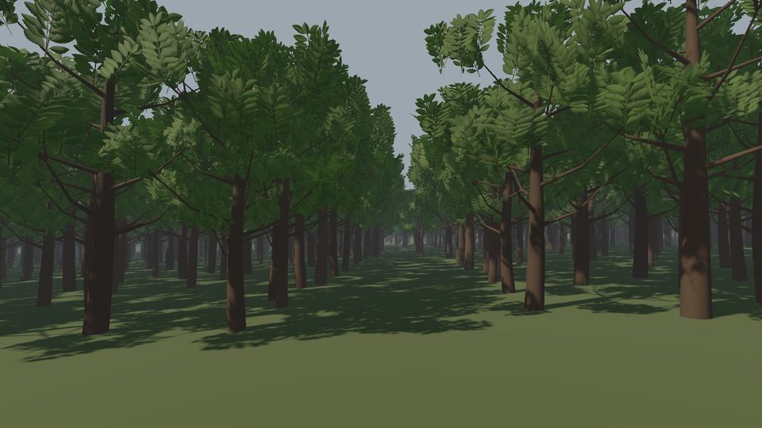
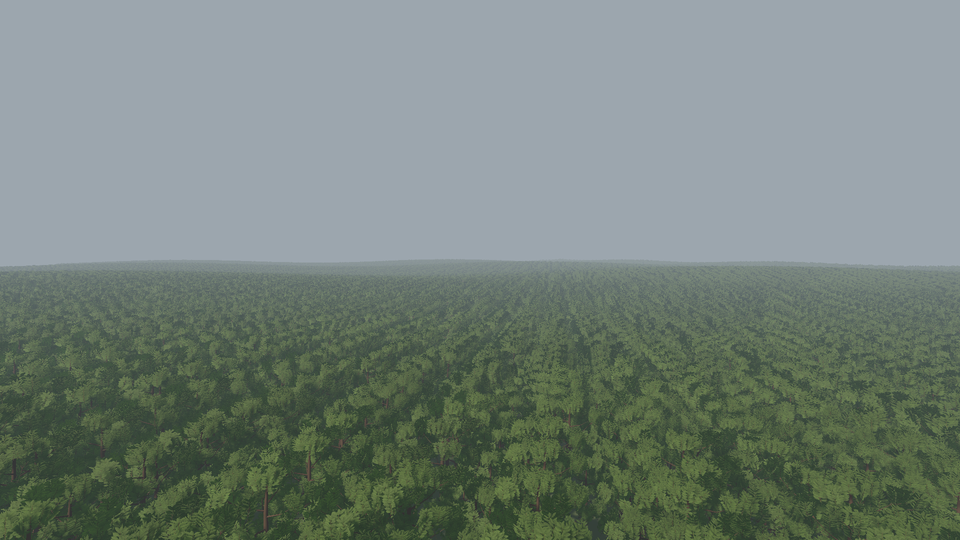

# Reference-based foliage quality, 2026-11-02

This pass improves the authored reference tree and its rendering, then exercises
100,000 trees over approximately 1.74 km. It changes assets, shader behavior and
distance representations. Historical forest timing/pixel-equivalence cohorts
remain tied to their original sources; this is a new workload.

- Explicit shared wind response and branch/leaf phases, following the structure
  of [Crytek's vegetation animation](https://developer.nvidia.com/gpugems/gpugems3/part-iii-rendering/chapter-16-vegetation-procedural-animation-and-shading-crysis).
- Original leaf-spray albedo, folded normals and ORM/transmittance maps, with
  thin-leaf lighting informed by [SpeedTree's rendering discussion](https://developer.nvidia.com/gpugems/gpugems3/part-i-geometry/chapter-4-next-generation-speedtree-rendering).
- Authored alpha-coverage mip chains using the same 0.32 cutoff as rendering,
  following [Castaño's alpha-mipmap technique](https://www.ludicon.com/castano/blog/articles/computing-alpha-mipmaps/).
  Native and web backends preserve the full DDS chain, including Raw channels.
- A source-mesh baker and optional 24-view hemisphere impostor, informed by
  [Epic's impostor baker](https://dev.epicgames.com/documentation/en-us/unreal-engine/impostor-baker-plugin-in-unreal-engine).
  This uses an azimuth/elevation grid, not octahedral mapping.
- Moving local mesh selection, complementary geometry crossfades, and common
  post-lighting fog for terrain, meshes and impostors.

The fixture uses the ordinary ECS and Render3D submission paths. Its three
geometry levels contain 1,670 / 668 / 90 triangles per tree. Mesh crossfades
span 80–100 m and 250–310 m; the optional atlas crossfade spans 430–510 m.
Every frame still accounts for all planted trees and verifies unchanged match
state. See [controls and asset reproduction](../../forest/README.md).

## Visual witnesses

These downsampled 960×540 witnesses come from finite native Vulkan captures at
1920×1080. Wind, mapped foliage, shadows and fog are enabled; each run retains
100,000 trees. Full images, close source/forced-atlas comparisons at two angles,
fog-off control and a 16-frame approach/retreat sequence remain in the ignored
`build/foliage-quality/captures` directory. Their hashes, exact settings, primary
levels and submitted instance counts are in [validation.json](validation.json).
Short capture-run timing fields are diagnostics and are not performance evidence.

The close forced-atlas images deliberately magnify its limits: lost fine leaf
detail, 45-degree view spacing and nearest-layer disocclusion. The normal usage
keeps geometry nearby. The atlas sways as a whole rest-pose card, cannot animate
individual baked branches, and uses proxy geometry for depth, lighting position
and fog. It never casts shadows. UV/height/emission maps are unsupported on this
prototype; scalar emission and surface edits remain available. Very coarse
atlas mip tails inevitably mix views. Unity currently retains only base pixels
instead of the authored mip chain. This does not claim pixel equivalence or a
general quality optimum, and it introduces no Gaussian tree representation.

## Correctness and integration

The native sanitizer, web-release and ordinary native release builds succeed.
The documentation production build succeeds. The final scoped native integration
passes all 115 CTests in 35.00 seconds. All 120 scoped web-release CTests pass
in 378.81 seconds. Coverage includes the shader goldens and explicit-gradient errors,
SPIR-V/HLSL validation, actual explicit-mip pixels through helpers, DDS/raw pack
levels, unsupported-BC fallback, local mesh changes, opaque/cutout shadow
exclusion, lighting, wind, fog and every moving-camera representation/transition.

The initial integrated build exposed two explicit package source lists that
needed the new wind/fog/impostor files: bench_render3d and the declarations-only
compiler fixture. Both are corrected and included in the final build/check scope.

An early combined atlas shader expanded implicit gradients through sampled
depth, causing excessive pipeline memory/time. The final implementation uses
separate optional impostor programs and four affine explicit-gradient footprints.
Bounded Vulkan standard/forced-atlas/moving checks pass without guard activation;
ordinary Lit/Deform does not contain the atlas graph. Initial depth lookups remain
bilinear, while final albedo, model-normal/depth and masks use trilinear sampling.

## Controlled measurement status

[run.ps1](run.ps1) owns the same shared mutex as `perf-pass/gate.ps1`; do not wrap
it in that gate. It waits at most 90 seconds for recognized builds/tests to be
quiet, then runs twelve alternating release processes: two rounds of mesh-only
versus distant impostors from ground/canopy/wide, with 20 warmup and 100 measured
frames each. It monitors recognized contenders throughout and withholds a clean
cohort if one appears. Tree/settings/sample/world-state invariants are checked;
geometry/visible counts and configuration hashes may differ by representation.
CPU/GPU intervals overlap and native completion includes readback; they are not
shipping FPS. Two rounds would provide local observations, not a general claim.

The first bounded attempt acquired/released the mutex normally and launched zero
measurement children because another browser correctness run remained active.
Its [status](attempt-20261102T043149Z/status.json) is retained, with external
process arguments omitted. After all final checks/captures/builds completed,
the [second attempt](attempt-20261102T044800Z/status.json) acquired the gate at
04:49:12.689 UTC and released/disposed it at 04:50:42.733 UTC. Recognized external
correctness checks remained active for its 90-second quiet guard. It also
launched zero measurement children. **New quality-path timings and speedup
claims are withheld.** No benchmark/gate process remains queued from this task.

Other native OSes, mobile, Unity execution and hardware-web performance were not
run locally. No extra CI run was dispatched.
