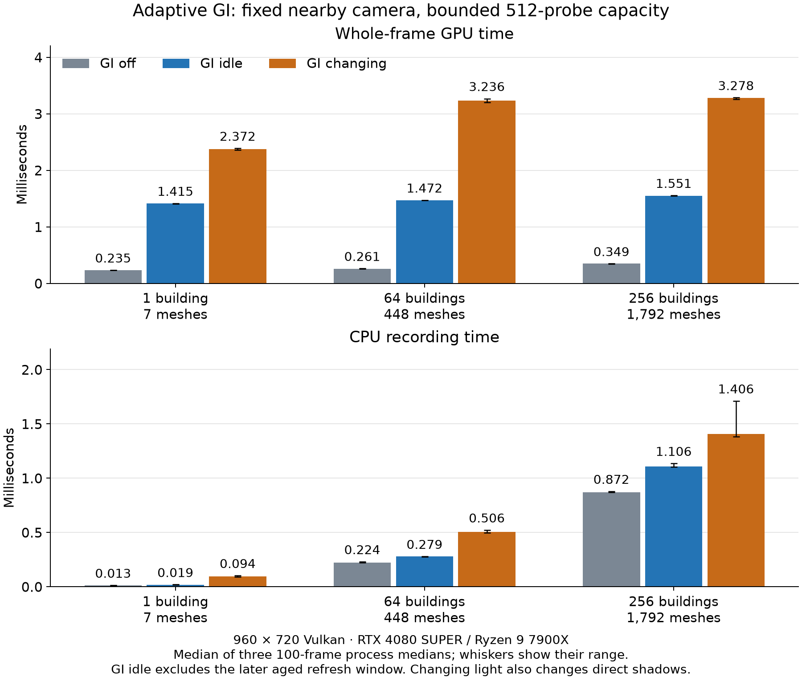
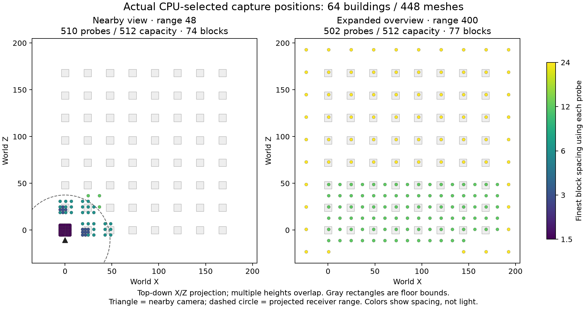

# Adaptive world GI: placement, scaling and limits

The geometry-aware field retains nearby detail as distant geometry is added.
In this fixed-camera workload, 64 and 256 buildings use the same 510 physical
probes in 74 blocks and retain spacing 1.5 at the primary floor receiver.
CPU scene traversal still scales with instance count. Camera-driven topology
rebuilding remains expensive: the separate travel run reaches
14.422 ms CPU recording at p95. This is experimental
work on `feat/render3d-gi`, with no merge to dev and no light baker.

## Source and validation

- Measured source: `b1c69748f47a800269fae11fbf7d4f3370df7c8c`.
- Release executable SHA256: `d54420435d89e0ed455c88665b26f7826f32d82536391d2f8f1a53f5affc3318`.
- Windows 11 Pro build 26200; Ryzen 9 7900X, RTX 4080 SUPER,
  NVIDIA 617.42; Clang 23.1.2, optimized unsanitized `RelWithDebInfo` / `-O2`.
- Seven focused native ASan CTests pass on Vulkan with validation and OpenGL.
  Eighteen focused web-debug checks pass on WebGL, ANGLE D3D11/WARP and WebGPU.
  The package CPU fixture has 22 cases. Native ASan also passes actual district,
  expanded-overview and 240-frame travel/moving-light cases. The docs build passes
  on Node 24.22.1. Logs are in [validation/](validation/).
- Every original lighting oracle remains, including exact wall/floor receivers,
  constant and directional integration, visibility, sphere contact, thin-wall
  leakage, mapped skinning, frozen history and unchanged match hashes. Browser
  pixels run as four independent groups under the unchanged 120/100-second
  guards; the slowest local case was D3D11 room at 119.92 seconds.

Other native OSes, Android, Unity execution and device-loss recovery are not
locally exercised. This is no hardware-independent quality or timing guarantee.

## Controlled workload and method

The district repeats the same seven-mesh room on a 24-unit grid. Counts 1/64/256
mean 7/448/1792 mesh instances, checked against actual package scene bookkeeping.
The primary camera, materials, exposure and point light are fixed; every room
also has an emissive panel. GI-off reports zero package instances because its
bookkeeping is disabled, while the actual rendered scene is retained.

GI uses base spacing 1.5, capacity 512, view/capture distances 48, refresh age 600
and maximum four captures/frame. All three short cases use 960×720 Vulkan,
20 warmup and 100 measured frames, after independent cold initialization.
Three adjacent trials use forward/reverse/forward count and case order.
The 27 short processes retain all 2700 GPU samples. Three separate static
256-building runs use 1200 measured frames each, reaching aged background work;
all 3600 samples are retained. The final comparison ran from
2026-11-02T00:40:53.7750126+00:00 to 2026-11-02T00:44:38.3498797+00:00.

Another local task deferred builds/tests/captures while these runs used the
shared mutex and five-second quiet gate. The gate does not continuously monitor
contention; desktop activity, clocks and temperatures are not controlled or
normalized. GPU snapshots are retained before and after every process.
A prior [interrupted start](diagnostics/interrupted-start/README.md) is preserved
separately and is not pooled with this comparison. Earlier pre-fixture-fix
exploratory district rows actually contained one room and are not scaling evidence.

Values below are medians of three process medians; parentheses show their range.
P95 summaries are medians of three process p95 values, not pooled percentiles.
GPU timings cover the whole rendered frame. CPU recording, submission and GPU
intervals overlap and must not be added. Synchronous native readback prevents
interpreting these values as shipping game FPS. Moving-light also changes direct
shadows; there is no matching moving-light GI-off control, so its cost difference
does not isolate GI overhead. No old-grid before/after speedup is claimed.

## Warmed costs



| Buildings | Meshes | Case | GPU ms (range) | CPU record ms (range) | Captures/frame |
|---|---|---|---|---|---|
| 1 | 7 | GI off | 0.235 (0.235–0.236) | 0.013 (0.013–0.013) | 0.000 |
| 1 | 7 | GI idle | 1.415 (1.410–1.416) | 0.019 (0.019–0.020) | 0.000 |
| 1 | 7 | GI changing | 2.372 (2.361–2.390) | 0.094 (0.092–0.103) | 4.000 |
| 64 | 448 | GI off | 0.261 (0.259–0.264) | 0.224 (0.221–0.230) | 0.000 |
| 64 | 448 | GI idle | 1.472 (1.470–1.474) | 0.279 (0.278–0.279) | 0.000 |
| 64 | 448 | GI changing | 3.236 (3.199–3.269) | 0.506 (0.498–0.522) | 4.000 |
| 256 | 1792 | GI off | 0.349 (0.347–0.349) | 0.872 (0.871–0.878) | 0.000 |
| 256 | 1792 | GI idle | 1.551 (1.547–1.556) | 1.106 (1.104–1.136) | 0.000 |
| 256 | 1792 | GI changing | 3.278 (3.254–3.286) | 1.406 (1.384–1.711) | 4.000 |

The short static case has no captures: it measures the settled cache before
background refresh becomes eligible. The longer static window gives:

| 256 buildings, 1200 frames/process | Median ms | P95 ms |
|---|---|---|
| GPU | 1.563 | 3.621 |
| CPU recording | 1.168 | 2.046 |

That window averages 0.602 captures/frame, including
idle frames and bounded refresh bursts. Its range and every raw process statistic
are in [summary.json](summary.json) and [long-static-chart-data.csv](long-static-chart-data.csv).

## Allocation and cold recording

| Buildings | Physical probes / capacity | Blocks | Finest spacing | Primary floor spacing |
|---|---|---|---|---|
| 1 | 364 / 512 | 46 | 1.5 | 1.5 |
| 64 | 510 / 512 | 74 | 1.5 | 1.5 |
| 256 | 510 / 512 | 74 | 1.5 | 1.5 |

Adding the nearby buildings changes the field from 364 to 510 probes. Adding the
more distant buildings from 64 to 256 does not coarsen that field. Sparse blocks
share coincident anchors and omit anchors whose interpolation support cannot
reach receiver bounds. Triangle-based relocation further adjusts capture points.



This map uses actual CPU-selected anchors plus relocation offsets from the
unchanged production generated game. Gray footprints are transformed floor AABBs,
not exact mesh silhouettes. Heights overlap in the X/Z projection; colors show
the finest block spacing sharing a probe, not irradiance. The overview expands
view distance from 48 to 400 and is a different coverage workload. The same
capacity then spreads over the district at coarser levels.

The [placement exporter](placement/probe_export.c) records commands without GPU
submission. Its captured/dirty flags are CPU bookkeeping, not lighting evidence.
It stops after initializing slots and one additional frame, leaving 8/10/2 dirty
records in the room/nearby/overview snapshots. An auxiliary verifier initially
assumed every record was clean; the original failed check is retained, and the
corrected [structural verifier](placement/verify.py) validates IDs, support masks,
positions, finite offsets and bounds while preserving those flags.

Cold CPU recording is separate from warmed performance:

| Buildings | First enabled setup frame ms | Cumulative fill recording ms |
|---|---|---|
| 1 | 2.616 | 7.778 |
| 64 | 15.544 | 48.738 |
| 256 | 25.787 | 92.332 |

The setup frame includes planning and capture command recording; cumulative fill
includes validation/fill recording. These exclude asset loading and do not time
GPU convergence end to end. The synchronous topology planner is not a constant-cost
operation and remains the main streaming limitation.

## Actual captures and travel

[GI on](captures/room-on.png), [GI off](captures/room-off.png),
[probe markers](captures/room-probes.png),
[256-building nearby view](captures/district-on.png),
[64-building expanded overview](captures/district-probes.png), and
[travel](captures/travel-quiet.png) are actual 960×720 engine captures.
The same-room pair shares the camera, direct lighting, materials and exposure.
The initial capture-only rows were collected under concurrent build load; their
timing fields are not performance evidence. `capture-run.json` retains their inputs.

One additional quiet travel process moves through 64 buildings at 12 units/sec
with a moving primary light, four captures/frame, one warmup and 240 measured
frames. It retains all 240 GPU samples; this single process is not pooled with
the three-trial comparison. Its row and log are [travel-quiet.jsonl](travel-quiet.jsonl)
and [travel-quiet.log](travel-quiet.log).

| Travel, single 240-frame process | Median ms | P95 ms |
|---|---|---|
| GPU | 3.927 | 6.643 |
| CPU recording | 0.558 | 14.422 |

The ending field has 454 active probes and 440
pending captures/refreshes. It is progressive rather than fully refreshed.
Visible spatial bands and coarse/partial support remain. The direct point light
stays in the primary room; later rooms have only their emitter. This one-bounce
implementation excludes received GI from captures, so it cannot carry an
emitter-to-floor-to-box second diffuse bounce. Finite capture range, limited
probes, skinned/deformed rest bounds and main-camera shadow coverage remain limits.

## Reproduction and retained evidence

Copy `run-scaling.ps1`, `summarize-scaling.py` and `REPORT_TEMPLATE.md` from this
directory into an ignored `build/gi-adaptive/` directory **before** checking out
the measured source. The runner expects that two-level location. Then check out
the source SHA above, build `bench_globalillumination` with the release preset,
finish correctness checks, coordinate a quiet window, and run:

```powershell
$env:TIDE_HIDDEN = '1'
pwsh -NoProfile -File build/gi-adaptive/run-scaling.ps1 `
  -SourceSha b1c69748f47a800269fae11fbf7d4f3370df7c8c `
  -ReportDirectory build/new-gi-evidence -LongStatic
```

The destination must be new or empty. Source HEAD/cleanliness, binary hashes,
scene counts, sample counts and successful correctness exits are checked around
each process. The runner performs no builds, retries, CI dispatches or publication.
`raw/` retains all 30 process logs/rows/run metadata. `runs.jsonl`, `summary.json`,
the CSV files and `metadata.json` retain statistics and identities; `build-commands.txt`,
the CMake files and input hashes identify the build. `plot-results.py` and
`plot-placement.py` generate the PNG/SVG figures with versions in `plotting.json`.
`placement/evidence.json` separately identifies its scratch exporter executable.
No executable, object file or PDB is committed.

Captured bytes are preserved by this directory's local `-text` Git attribute,
so evidence checksums also cover native newline bytes. Production source keeps
the repository's ordinary text policy.
